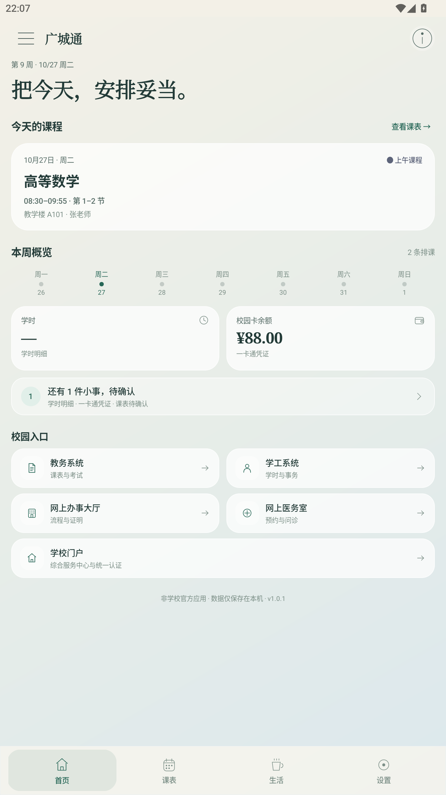
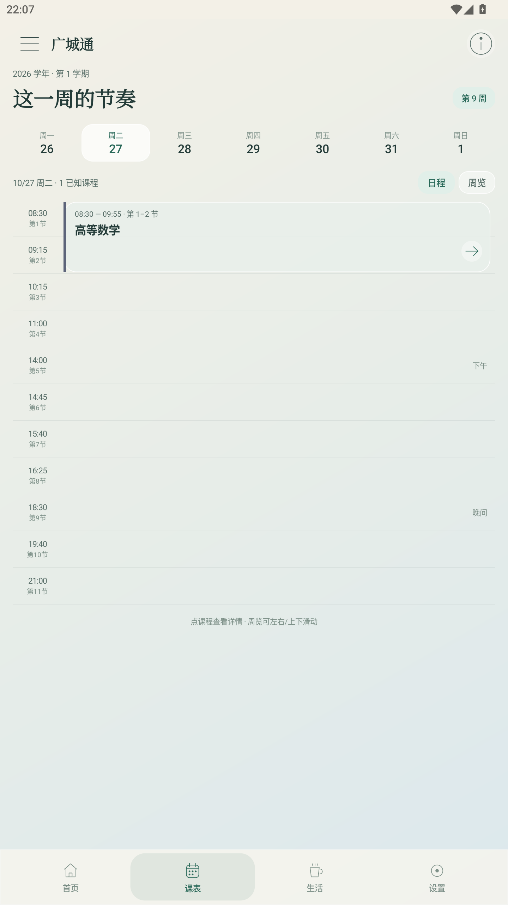
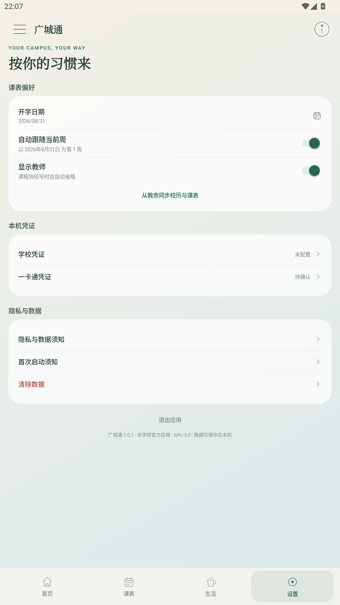

<div align="center">
  
  <h1>广城通</h1>
  <p><b>广州城市职业学院校园信息聚合客户端</b><br/>课表 · 学业 · 学工 · 校园卡 · 热水 · 图书馆 · 校园服务</p>
  <p>
    <a href="https://github.com/WASD258-jpg/guangcheng-tong/releases/latest"></a>
    <a href="LICENSE"></a>
    
    
    <a href="https://github.com/WASD258-jpg/guangcheng-tong/stargazers"></a>
  </p>
  <p>
    <a href="#下载">下载</a> ·
    <a href="#功能">功能</a> ·
    <a href="#构建">构建</a> ·
    <a href="docs/ARCHITECTURE.md">架构</a> ·
    <a href="SECURITY.md">安全</a> ·
    <a href="CONTRIBUTING.md">贡献</a> ·
    <a href="CHANGELOG.md">更新日志</a>
  </p>
</div>

> **非学校官方应用。** 本项目是个人开发的本地优先客户端，与广州城市职业学院及其信息化部门没有隶属、授权或合作关系。使用风险由你自行承担。

## 简介

广城通把分散在门户、教务、学工、一卡通、图书馆和微信小程序里的校园入口，收进一个 Android 原生客户端。它不运营服务器、不收集数据：账号、密码、课表、余额和电子证只留在本机。

项目选择 **平台原生组件 + 手写设计系统**，不依赖 Gradle、AndroidX 或第三方 UI 库；所有界面、图标、动画、网络请求和 Keystore 凭证逻辑都在 `src/cn/gct/demo` 中可审计。

## 界面

> 以下为 MuMu 模拟器竖屏截图，课程、教师、教室、余额均为虚构示例，不含真实个人信息。

| 首页 | 课表 |
| :---: | :---: |
|  |  |
| **设置** |  |
|  |  |

## 功能

- 📅 **课表**：教学周切换、单日 11 节时间轨道、周览、课程详情、教师显隐、调课/重叠提示。
- 🏠 **首页**：今日课程、本周概览、学时/余额、待确认事项和校园入口聚合。
- 🎓 **学业/学工**：从学校登录态读取学时；学工移动端 HTTP 需明确确认。
- 💳 **校园卡**：一卡通电子账户余额同步，凭证用 Android Keystore AES-GCM 加密，验证码手动。
- 🚿 **热水**：从稳定入口 `mh60.gcp.edu.cn` 解析当前微信小程序 `url_scheme`，直接拉起微信。
- 📚 **图书馆**：馆藏检索、借阅/续借 OPAC、本地电子证亮码与导入说明。
- 🏫 **校园服务**：学校门户、教务系统、办事大厅、网上医务室，门户与教务分开。
- 🎨 **设计**：晨雾渐变、玻璃面板、手绘线性图标、页面 280ms 过渡、四页底部导航。
- 🔐 **本地优先**：无账号、无服务器、无统计、无广告、无崩溃上报；`allowBackup=false`。

## 下载

从 [Releases](https://github.com/WASD258-jpg/guangcheng-tong/releases/latest) 下载：

- 当前版本：**1.0.1**（versionCode 1001）
- 文件：`guangcheng-1.0.1.apk`
- 包名：`cn.gct.demo`
- 系统：Android 8.0（API 26）及以上
- SHA-256：`5D755906C71F21595585250DFE139976B3C61098CDAE233727C31530F3ADE6A2`

> 1.0.1 与 1.0 使用同一 release keystore，可从 1.0 覆盖升级；从 0.99rc19 升级因签名不同，必须先卸载，本地数据会清空。正式签名证书 SHA-256：`8d4699d2c69f1771695804fa4fb8a5adaa88001054c0ef7c0ccbf42d084c25a3`。

## 构建

需要 JDK 17、Android SDK 34 和 build-tools 34.0.0；**不需要 Gradle**。

```powershell
$env:JAVA_HOME = 'C:\Program Files\Eclipse Adoptium\jdk-17.0.20.8-hotspot'
$env:ANDROID_HOME = 'D:\Android\sdk'
$env:RELEASE_KS_PASS = '<your release keystore password>'
pwsh -File .\build-demo.ps1
```

详细步骤、签名和 release keystore 说明见 [docs/BUILDING.md](docs/BUILDING.md)。构建脚本按 `javac → d8 → aapt → zipalign → apksigner` 手动打包；release keystore 与口令只在本地，不提交。

## 项目结构

```text
src/cn/gct/demo/      Java 源码（单 Activity、无第三方 UI 库）
assets/               WebView 注入的校历/课表/学时脚本
res/                  自适应图标、网络配置、主题
docs/                 架构、构建
build-demo.ps1        手动构建与签名脚本
AndroidManifest.xml   清单（仅 INTERNET，allowBackup=false）
```

## 安全与隐私

- 不收集、不上传、不运营服务器；没有账号、注册、统计、广告或崩溃上报。
- 密码用 Android Keystore AES-GCM 加密；账号、课表、余额保存在应用私有目录。
- WebView 只允许学校域名与必要的图书馆/OPAC 例外；未开启 JavaScript 原生桥；SSL 错误直接取消。
- 凭证预填只对 `https://auth.gcp.edu.cn` 等明确页面生效，验证码始终手动。
- 已知风险、已修项和正式版签名说明见 [SECURITY.md](SECURITY.md)。

> 已知限制：学工移动端与图书馆 OPAC 仍使用学校提供的 HTTP 明文；`assets/extract-hours.js` 仍包含学校服务端下发的 Basic 凭证。这是学校接口现状，项目保留并在安全文档中记录，不把它当作客户端可独自解决的问题。正式版建议学校轮换该凭证并提供 HTTPS。

## 已知限制

- 仅面向广州城市职业学院；学校接口调整后可能需要更新解析脚本。
- 学工 HTTP、图书馆 OPAC HTTP 与上述 Basic 凭证属于学校侧现状。
- 本项目不提供任何学校账号、成绩、余额或电子证数据；请使用本人账号。
- 非官方项目，不提供任何形式的担保。

## 贡献

欢迎 Issue 和 Pull Request。提交前请先读 [CONTRIBUTING.md](CONTRIBUTING.md)：保持平台原生、不引入第三方 UI 库，不要提交真实账号、密码、Keystore 或个人信息。安全问题请不要公开 Issue，按 [SECURITY.md](SECURITY.md) 的方式处理。

## 许可证

本项目以 [GNU General Public License v3.0](LICENSE) 开源，另见 [NOTICE](NOTICE)。你可以自由使用、修改和分发，但衍生作品需继续以 GPL-3.0 开源，且不提供担保。

<div align="center">
  <a href="https://star-history.com/#WASD258-jpg/guangcheng-tong&Date">
    
  </a>
  <br/><br/>
  <sub>非学校官方应用 · 本地优先 · GPL-3.0 · 请使用本人账号并自行保护设备</sub>
</div>
